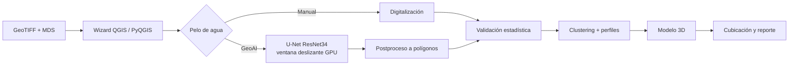

# bathymetry-geoai-qgis

**Plugin QGIS para batimetría de piscinas con GeoAI (U-Net/ResNet34)**

> 🔒 **Código privado.** Este repositorio es un *showcase*: documenta el problema, la solución y la arquitectura. El código fuente pertenece a un proyecto profesional y no se publica. No incluye datos reales, credenciales ni información de clientes.

## English summary
A modular QGIS plugin (wizard) that unifies the full pool-bathymetry workflow: raster loading, water-edge detection with a self-trained U-Net/ResNet34 segmentation model (GPU sliding-window inference), statistical validation, profiles, 3D model and volume computation. In operation: processing time dropped from ~1 business day to 1–2 hours.

## Problema
La batimetría de piscinas en minería combinaba varias herramientas y pasos manuales: cargar ortomosaicos y modelos de superficie, digitalizar a mano el pelo de agua, validar puntos, generar perfiles y cubicar. El proceso completo tomaba **alrededor de un día hábil** por levantamiento y dependía mucho del operador.

## Solución
Un plugin QGIS modular con asistente paso a paso (10 fases) que guía todo el flujo dentro de QGIS:

1. Carga de GeoTIFF (ortomosaico) y MDS.
2. **Pelo de agua** manual o automático con **GeoAI**: modelo de segmentación **U-Net con encoder ResNet34, entrenado por mí** con datos propios de dron. Inferencia por ventana deslizante (1024 px, solape 512) en GPU y postproceso a polígonos.
3. Validación estadística de puntos.
4. Clustering de puntos.
5. Perfiles.
6. Modelo 3D de fondo.
7. Cubicación y reportes.

**Resultado:** en operación; el proceso bajó de **~1 día hábil a 1–2 horas**.

## Arquitectura

El modelo corre en un entorno Python aislado (llamado por subprocess) para no mezclar dependencias de deep learning con las de QGIS.

## Stack
PyQGIS (QGIS 3.28–4.x) · Python · GDAL · NumPy/SciPy · Shapely · PyTorch · U-Net/ResNet34 (geoai) · CUDA · pytest

## Métricas verificadas
| Indicador | Valor |
|---|---|
| Tiempo de proceso | ~1 día hábil → 1–2 horas |
| Estado | En operación |
| Versión | v0.47 · 10 fases |
| Tests automatizados | ~150 (pytest) |

## Capturas
<!-- TODO: agregar captura del wizard con datos sintéticos -->

<!-- TODO: agregar captura de máscara de pelo de agua sobre ortomosaico sintético -->

## Autor
Tito Ruiz Haros · [github.com/titoruizh](https://github.com/titoruizh)
